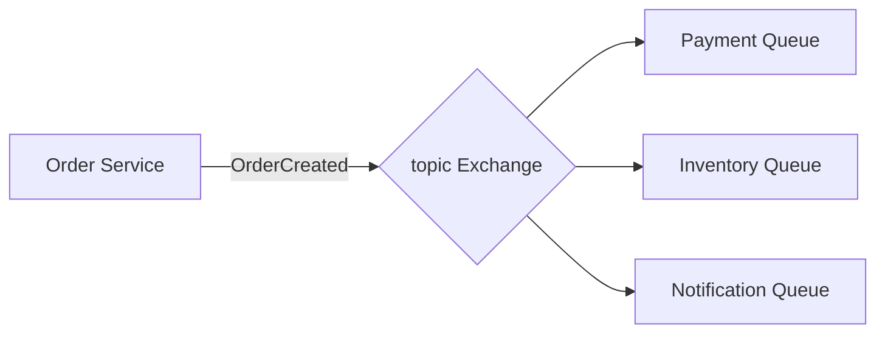

# فصل اول: مبانی سیستم‌های پیام‌رسانی

## فهرست مطالب
- [Message Broker](#message-broker-چیست)
- [Queue و پیام‌رسانی غیرهم‌زمان](#queue-و-پیام‌رسانی-غیرهمزمان)
- [Communication Patterns](#communication-patterns)
- [Event-Driven Architecture](#event-driven-architecture)
- [چرخه عمر پیام](#چرخه-عمر-پیام)

## مقدمه
Messaging روش ارتباط سرویس‌ها از طریق **پیام** است؛ نه با پاسخ مستقیم و هم‌زمان. این فصل پایه تصمیم‌های فصل‌های بعدی را می‌سازد.

## Message Broker چیست؟
**Message Broker** برنامه میانی بین فرستنده و گیرنده است. وظایف اصلی: دریافت پیام، نگهداری آن، مسیریابی، تحویل، ACK/NACK، و مدیریت پیام‌های ناموفق.

Synchronous HTTP پاسخ را منتظر می‌ماند؛ Asynchronous Messaging یک قرارداد زمان‌بندی را کاهش می‌دهد. Broker با API Gateway متفاوت است: Gateway مسیر درخواست و سیاست API را کنترل می‌کند، اما Broker انتقال غیرهم‌زمان و پیام‌محور را مدیریت می‌کند.

## Queue و پیام‌رسانی غیرهم‌زمان
**Queue** مخزن نام‌دار و مرتب برای پیام‌هاست. ترتیب تحویل معمولاً در RabbitMQ روی یک Queue، برای مسیر تحویل موفق و بدون مصرف‌کننده‌های رقیب تضمین‌شده‌تر است، اما چند Consumer، Requeue و خطاها می‌توانند ترتیب نهایی پردازش را تغییر دهند.

Queue با Database متفاوت است؛ Queue برای تحویل و مصرف کاری است، نه ذخیره‌سازی بلندمدت گزارش‌ها. Database جستجو، رابطه و تراکنش را بهینه می‌کند؛ Broker تحویل غیرهم‌زمان را بهینه می‌کند.

## تفاوت Synchronous و Asynchronous

| ویژگی | Synchronous | Asynchronous |
|---|---|---|
| پاسخ | منتظر پاسخ یا timeout | معمولاً قبول درخواست فوری |
| وابستگی | سرویس مقصد باید در لحظه اجرا باشد | پیام تا آماده شدن Consumer نگهداری می‌شود |
| مقیاس‌پذیری | محدود به زمان پاسخ مقصد | پردازش را از پذیرش درخواست جدا می‌کند |
| خطا | استثنای مستقیم به Caller | Retry، DLQ و Compensation |

مزیت Asynchronous، کاهش Coupling و مدیریت بهتر Bursty Traffic است؛ معایب آن شامل تکراری بودن ممکن پیام، افزایش سختی Debug و نیاز به مراقبت نهایتاً سازگار هستند.

## Communication Patterns

### Point-to-Point
یک پیام به‌طور معمول به یک Consumer از بین چند Consumer روی یک Queue تحویل می‌شود. برای کارهایی مثل پردازش ایمیل مناسب است.

### Publish/Subscribe
Publisher یک پیام را به یک Exchange می‌فرستد و چند Queue مستقل آن را دریافت می‌کنند؛ هر سرویس می‌تواند نسخه خود را پردازش کند.

## Producer و Consumer

- **Producer/Publisher:** پیام را تولید و منتشر می‌کند؛ برای ارسال، تأیید و بررسی شکست مسئولیت دارد.
- **Consumer:** پیام را دریافت و پردازش می‌کند؛ ACK فقط پس از موفقیت کامل یا ثبت مطمئن نتیجه ارسال می‌کند.

## Message Contract
هر پیام باید دارای یک قرارداد سازگار باشد: نام نوع، زمان‌بمایش، شناسه، schema و قواعد نسخه‌بندی. با زبان ساده، Contract را می‌توان معادل «فرمت نامه» دانست.

```json
{
  "messageId": "7e7adac7-9d94-4e52",
  "messageType": "OrderCreated",
  "occurredAt": "2026-11-20T18:30:00Z",
  "orderId": "ORD-1001",
  "customerId": "CUS-42",
  "total": 125000
}
```

## Event-Driven Architecture
رویداد، واقعیات گذشته است؛ مثلاً `OrderCreated`. **Command** درخواست انجام کاری است، مثلاً `ShipOrder`. در معماری رویدادمحور، سرویس‌ها با پیام‌های از پیش تعریف‌شده ارتباط دارند و اغلب Eventual Consistency را می‌پذیرند.



## چرخه عمر پیام
1. Publisher یک پیام ایجاد می‌کند.
2. RabbitMQ آن را طبق Exchange و Binding مسیریابی می‌کند.
3. پیام در Queue ذخیره می‌شود.
4. Consumer آن را دریافت می‌کند.
5. پس از موفقیت، Consumer ACK می‌فرستد.
6. RabbitMQ پیام را حذف می‌کند؛ در صورت شکست می‌تواند Requeue یا Dead-Letter کند.

## سناریوی واقعی فروشگاه
بعد از ثبت سفارش، `OrderCreated` منتشر می‌شود. سرویس پرداخت آن را برای شروع پرداخت، انبار برای رزرو محصول و اعلان برای ارسال پیام به کاربر مصرف می‌کند. هر سرویس Queue مستقل و Consumer خود دارد؛ پاک شدن یک Queue نباید عمل سایر سرویس‌ها را مختل کند.

## اشتباهات رایج
- استفاده از Queue به‌عنوان Database
- انتظار FIFO دقیق بین چند Consumer یا Requeue
- ارسال پیام‌های بزرگ به‌جای ذخیره داده و ارسال Reference
- نشستن روی ACK قبل از پایان یا ذخیره‌سازی موفقیت

## تمرین عملی
سناریو یک آژانس سفر بنویسید که Eventهای `TripBooked`، `TicketIssued` و `TripCancelled` را منتشر و مصرف می‌کند. برای هر سرویس نوع ارتباط Point-to-Point یا Pub/Sub را تعیین کنید.

## جمع‌بندی
Broker واسطه، Queue محل نگهداری، Publisher تولیدکننده و Consumer پردازشگر هستند. Asynchronous Messaging وابستگی زمانی را کم می‌کند اما قابلیت اطمینان، تکراری بودن، نسخه پیام و Observability را ضروری می‌سازد.

## منابع
- [RabbitMQ AMQP Concepts](https://www.rabbitmq.com/tutorials/amqp-concepts)
- [RabbitMQ Tutorials](https://www.rabbitmq.com/tutorials)
- [Microsoft Cloud Design Patterns](https://learn.microsoft.com/en-us/azure/architecture/patterns/)
