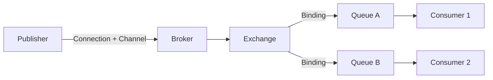

# فصل سوم: معماری داخلی RabbitMQ

## فهرست مطالب
- [Broker و Connection](#broker-و-connection)
- [Channel](#channel)
- [Virtual Host](#virtual-host)
- [Exchange، Queue و Binding](#exchange-queue-و-binding)
- [Routing Key و Message](#routing-key-و-message)

## مقدمه
RabbitMQ Broker یک یا چند Client را می‌پذیرد و پیام‌ها را به‌همراه Exchange، Queue و Binding مدیریت می‌کند.

## Broker
Broker فرایند RabbitMQ Server است که TCP Connectionها، Channelها، منابع، پروتکل‌ها و داده‌های Queue را مدیریت می‌کند.



## Connection
**Connection** یک ارتباط TCP طولانی‌مدت است. Heartbeat امکان تشخیص Client یا Network غیرعملیاتی را می‌دهد. برای هر پیام نباید Connection جدیدی ساخت؛ بلکه آن را به‌صورت Singleton یا pooled resource مدیریت کنید.

## Channel
**Channel** یک مسیر AMQP چندگانه داخل یک Connection است. ساخت Channel سبک‌تر از TCP است، اما بین چند Thread نباید به‌صورت همزمان و آزاد استفاده شود. بسیاری از SDKها Channel را non-thread-safe می‌دانند.

Channel-level Exception معمولاً فقط آن Channel را می‌بندد؛ Connection-level Exception کل ارتباط را باز می‌کند.

| ویژگی | Connection | Channel |
|---|---|---|
| لایه | TCP/AMQP | داخل Connection |
| هزینه | نسبتاً زیاد | سبک |
| تعداد | کم و بلندمدت | چندین برای عملیات |
| شکست | کل Session ممکن | فقط آن Channel ممکن |

## Virtual Host
**Virtual Host** دامنه منطقی جداسازی Exchange، Queue، Binding و Permission است. Virtual Host پیش‌فرض `/` است اما در Production جداسازی محیط‌ها و مشتریان توصیه می‌شود.

## Exchange
Exchange پیام را دریافت می‌کند و آن را بر اساس نوع Exchange و Bindingها به Queueها هدایت می‌کند. چهار نوع Native رایج: direct، fanout، topic و headers.

## Queue
Queue پیام‌ها را نگهداری و برای Push یا Pull تحویل می‌کند. Queueها می‌توانند Classic، Quorum یا Stream باشند. Queue یک endpoint مصرف است؛ لزوماً یک مکان ذخیره‌سازی طولانی‌مدت منطقی نیست.

## Binding
Binding ارتباط Exchange و Queue است. `binding key` در زمان اتصال Queue تعریف می‌شود. برای Topic Exchange با Routing Key پیام تطبیق می‌دهد.

## Routing Key و Binding Key
- **Routing Key:** برچسبی در هر پیام برای انتخاب مسیر.
- **Binding Key:** الگوی/کلید تعریف‌شده روی Binding.

برای Direct Exchange، این‌ها اغلب دقیقاً برابر هستند. برای Topic Exchange، Binding Key می‌تواند دارای `*` و `#` باشد.

## ساختار Message
پیام شامل:
- **Body:** محتوای JSON، بایت‌ها یا schema تعریف‌شده
- **Properties:** content type، correlation id، message id، delivery mode، expiration
- **Headers:** metadata سفارشی و routing

## C# با RabbitMQ.Client 7.x
```csharp
var factory = new ConnectionFactory
{
    HostName = "localhost",
    UserName = "demo",
    Password = "demo-password"
};

await using var connection = await factory.CreateConnectionAsync();
await using var channel = await connection.CreateChannelAsync();

await channel.ExchangeDeclareAsync("orders.topic", "topic", durable: true);
await channel.QueueDeclareAsync("orders.payment", durable: true, exclusive: false, autoDelete: false);
await channel.QueueBindAsync("orders.payment", "orders.topic", "order.payment.*");
```

> نام‌های Async API در نسخه‌های .NET Client دقیقاً باید با نوع 7.x سازگار باشند. کدهای قدیمی مانند `IModel` را با نسخه فعلی ترکیب نکنید.

## اشتباهات رایج
- ساخت Channel جداگانه برای هر عملیات کوچک بدون pooling و مدیریت
- استفاده همزمان یک Channel در چند Thread
- استفاده از Default Exchange برای همه الگوها
- نادیده گرفتن VHost در Permission

## تمرین عملی
یک خط مستقیم Publisher -> Exchange -> دو Queue بکشید و برای هر مؤلفه یک مسئولیت بنویسید.

## جمع‌بندی
TCP در Connection، عملیات AMQP در Channel، جداسازی در VHost و مسیریابی در Exchange صورت می‌گیرد. Queue پایان تحویل است و Consumer مسئول ACK است.

## منابع
- [RabbitMQ Networking](https://www.rabbitmq.com/docs/networking)
- [RabbitMQ .NET API Guide](https://www.rabbitmq.com/client-libraries/dotnet-api-guide)
