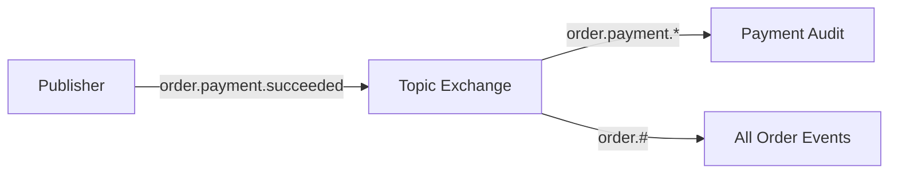

# فصل چهارم: انواع Exchange

## فهرست مطالب
- [Direct](#direct-exchange)
- [Fanout](#fanout-exchange)
- [Topic](#topic-exchange)
- [Headers](#headers-exchange)
- [Default](#default-exchange)

## مقدمه
Exchange پیام از Publisher را دریافت و با Bindingهای Queueها تطبیق می‌دهد. Routing Key توسط نوع Exchange تفسیر می‌شود.

## Direct Exchange
Routing Key و Binding Key باید دقیقاً یکسان باشند.

مثال: کلید `payment.succeeded` فقط به Queueهایی می‌رود که Binding دقیق مشابه دارند.

## Fanout Exchange
Routing Key نادیده گرفته می‌شود و پیام به تمام Queueهای bound ارسال می‌شود.

کاربرد: انتشار یک وضعیت به چند سرویس مستقل، مثلاً هشدار خاموش شدن برق.

## Topic Exchange
Routing Key چند بخش دارد و با نقاط جدا می‌شود. `*` دقیقاً یک بخش و `#` صفر یا چند بخش را تطبیق می‌دهد.

مثال:
- `order.payment.succeeded`
- Binding `order.payment.*`
- Binding `order.#`



## Headers Exchange
Routing بر اساس Headers انجام می‌شود؛ `x-match=all` یعنی همه headerها تطبیق دارند و `any` یعنی حداقل یکی.

Headers بیشتر برای metadataهای ظریف است؛ Topic برای Event Routing خواناتر است.

## Default Exchange
Exchange داخلی نام‌خالی است و فقط پیام را به Queue با نام همان Routing Key ارسال می‌کند. برای متغیرهای ساده مفید است و جایگزین Full Exchange Design نیست.

## مقایسه Exchangeها

| نوع | تطبیق | Routing Key | کاربرد |
|---|---|---|---|
| Direct | دقیق | بله | Job یا دسته مشخص |
| Fanout | تمام Queueها | نادیده گرفته | Broadcast |
| Topic | wildcard | بله | Event categories |
| Headers | properties | نادیده گرفته | فیلتر metadata |
| Default | نام Queue | بله | مسیر ساده |

## مثال C# کامل‌تر
```csharp
await channel.ExchangeDeclareAsync("notifications.topic", "topic", true);
await channel.QueueDeclareAsync("email.queue", true, false, false);
await channel.QueueDeclareAsync("push.queue", true, false, false);
await channel.QueueBindAsync("email.queue", "notifications.topic", "order.#");
await channel.QueueBindAsync("push.queue", "notifications.topic", "*.cancelled");

await channel.BasicPublishAsync(
    exchange: "notifications.topic",
    routingKey: "order.cancelled",
    mandatory: true,
    basicProperties: new BasicProperties(),
    body: JsonSerializer.SerializeToUtf8Bytes(new { orderId = "1001" }));
```

## اشتباهات رایج
- افزودن wildcardهای نامربوط در Direct Exchange
- استفاده از Fanout برای routing هدفمند
- طراحی Routing Key بدون قرارداد نسخه
- فراموش کردن `mandatory` و monitoring پیام‌های unrouteable

## تمرین عملی
برای خدمات اعلان، Email و SMS را با Topic Exchange بر اساس کشور و نوع Event مسیریابی کنید.

## منابع
- [RabbitMQ Exchanges](https://www.rabbitmq.com/docs/exchanges)
- [RabbitMQ AMQP Concepts](https://www.rabbitmq.com/tutorials/amqp-concepts)
