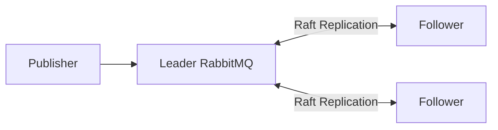

# فصل پنجم: انواع Queue

## فهرست مطالب
- [Classic Queue](#classic-queue)
- [Quorum Queue](#quorum-queue)
- [Stream Queue](#stream-queue)
- [ویژگی‌های Lifecycle](#ویژگیهای-lifecycle)
- [تفاوت Durable و Persistent](#تفاوت-durable-و-persistent)

## Classic Queue
Classic Queue یک صف سنترال برای نسخه‌های قدیمی/ساده RabbitMQ است. برای workloadهای ساده و کم‌حجم مناسب است اما ساختار Replication و تحمل شکست آن با Quorum برابر نیست.

## Quorum Queue
Quorum Queue داده را روی چند Node با الگوریتم Raft همگام می‌کند و نسبت به Node failure مقاوم‌تر است. در RabbitMQ 4.x برای Queueهای حیاتی گزینه اصلی محسوب می‌شود. ویژگی‌هایش شامل حداقل اکثریت برای عملیات، Redelivery و حداقل هزینه سازگاری هستند.



## Stream Queue
Stream Queue یک Log append-only است که مصرف‌کننده‌ها می‌توانند با offset خواندن کنند یا از موقعیت جدید شروع کنند. برای پردازش جریانی، Replay و تعداد Consumerهای زیاد مناسب است. رفتار آن شبیه Queue قدیمی نیست؛ پیام‌ها پس از ACK به‌طور خودکار حذف نمی‌شوند، بلکه بر اساس Retention حذف می‌شوند.

## Durable Queue
Durable بودن تعریف Queue را در restart باقی نگه می‌دارد. برای ماندگاری پیام، هر دو تعریف Durable Queue و پیام Persistent لازم است؛ حتی یک پیام Persistent روی Broker restart شده با Queue غير-Durable باقی نمی‌ماند.

## Exclusive Queue
Exclusive Queue فقط برای Connection سازنده قابل استفاده است و در هنگام بسته شدن آن حذف می‌شود. معمولاً برای Reply Queue یا RPC خصوصی استفاده می‌شود.

## Auto Delete
Queue بعد از قطع آخر Consumer حذف می‌شود. برخی تفاوت‌ها در نسخه و رفتار پشتیبان‌گیری وجود دارد؛ ویژگی‌ها را با مستندات نسخه مورد بررسی کنید.

## Temporary Queue
Queue خاص RPC که نام تصادفی و Exclusive دارد و تا زمان پایان Operation باقی می‌ماند.

## مقایسه

| نوع | ماندگاری | Replication | Replay | کاربرد |
|---|---|---|---|---|
| Classic | اختیاری | خیر/قدیمی محدود | معمولاً خیر | کار ساده |
| Quorum | بله | Raft | محدود/Redelivery | production حساس |
| Stream | بله | Replicated | offset و replay | event streaming |
| Exclusive | وابسته | خیر | خیر | پاسخ خصوصی |

## تفاوت Durable و Persistent
- `Durable`: ماندگاری metadata و تعریف Queue یا Exchange در restart.
- `Persistent`: تحویل/ذخیره پیام روی disk در صورت پشتیبانی Queue.
- یک Queue Durable کافی نیست اگر پیام DeliveryMode 1 باشد.

## C#
```csharp
await channel.QueueDeclareAsync(
    queue: "orders.quorum",
    durable: true,
    exclusive: false,
    autoDelete: false,
    arguments: new Dictionary<string, object?>
    {
        ["x-queue-type"] = "quorum"
    });
```

## اشتباهات رایج
- استفاده از Stream به‌جای صف کاری و انتظار حذف خودکار با ACK
- ترکیب Durable و Exclusive بدون طراحی دقیق
- فرض دقیقاً یکسان بودن Classic و Quorum
- استفاده از Queue Auto-delete برای سرویس Production

## تمرین عملی
سه Queue برای ایمیل، پرداخت و audit log طراحی کنید و نوع Queue، Durable بودن و نحوه retention را تعیین کنید.

## منابع
- [RabbitMQ Queues](https://www.rabbitmq.com/docs/queues)
- [Quorum Queues](https://www.rabbitmq.com/docs/quorum-queues)
- [RabbitMQ Streams](https://www.rabbitmq.com/docs/streams)
