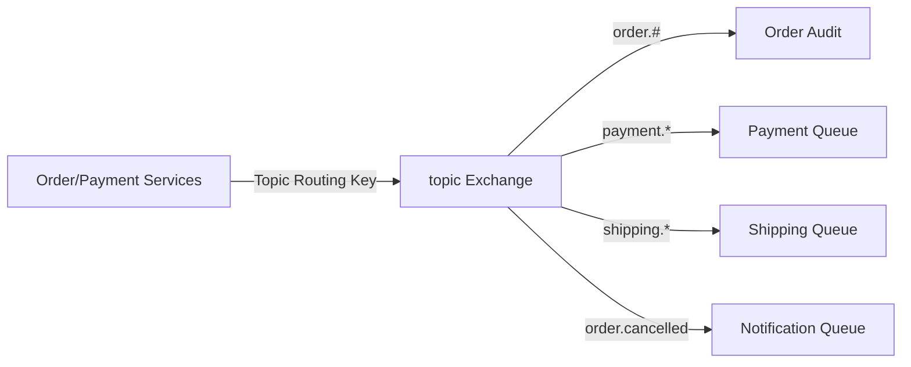

# فصل ششم: مسیریابی پیام

## فهرست مطالب
- [Routing و Binding](#routing-و-binding)
- [Wildcard Routing](#wildcard-routing)
- [Message Distribution](#message-distribution)
- [سناریوی اعلان](#سناریوی-اعلان)

## مقدمه
Routing تصمیم می‌دهد یک پیام وارد کدام Queue شود؛ Binding رابط Exchange و Queue است و Routing Key برچسب تصمیم‌گیری هر پیام است.

## Routing
1. Publisher Exchange را انتخاب می‌کند.
2. پیام Routing Key دریافت می‌کند.
3. Exchange Bindingهای تطبیق را بررسی می‌کند.
4. یک پیام می‌تواند وارد چند Queue شود.

## Binding و Routing Key
برای Direct Exchange تطبیق کلید دقیق است. برای Topic Exchange `*` یک بخش و `#` چند بخش را پوشش می‌دهد. برای Headers Routing Key نقش ندارد.

## Wildcard Routing
- `order.*.failed`: دقیقاً سه بخش و بخش میانی آزاد
- `order.#`: تمام کلیدهای شروع‌شونده order
- `#.cancelled`: پایان با cancelled

## Message Distribution
توزیع بین Queueها (Fanout) با توزیع بین Consumerها متفاوت است:
- یک Exchange پیام را به همه Queueهای تطبیق‌شده می‌فرستد.
- Consumerها روی یک Queue کار را رقیبانه تقسیم می‌کنند.

## سناریوی اعلان
رویدادهای سفارش با کلیدهای زیر مسیریابی می‌شوند:
- `order.created`
- `payment.succeeded`
- `shipping.dispatched`
- `order.cancelled`



## کد C#
```csharp
await channel.ExchangeDeclareAsync("events.topic", "topic", durable: true);

await channel.QueueDeclareAsync("notification.queue", durable: true,
    exclusive: false, autoDelete: false);
await channel.QueueBindAsync("notification.queue", "events.topic", "order.cancelled");
await channel.QueueBindAsync("notification.queue", "events.topic", "payment.succeeded");

var body = JsonSerializer.SerializeToUtf8Bytes(new
{
    eventId = Guid.NewGuid(),
    orderId = 1001,
    occurredAt = DateTimeOffset.UtcNow
});

await channel.BasicPublishAsync(
    exchange: "events.topic",
    routingKey: "payment.succeeded",
    mandatory: true,
    basicProperties: new BasicProperties { Persistent = true },
    body: body);
```

## اشتباهات رایج
- ساخت کلیدهای Routing بدون version و namespace
- انتظار یک Consumer خاص برای یک پیام ارسال‌شده به یک Queue مشترک
- استفاده از Topic Routing برای داده‌های متنی پیچیده

## تمرین عملی
برای رویدادهای `order.created`, `order.paid`, `order.shipped` و `order.cancelled` یک Topic Routing و جدول Queueها بنویسید.

## منابع
- [RabbitMQ Exchanges](https://www.rabbitmq.com/docs/exchanges)
- [RabbitMQ Publisher](https://www.rabbitmq.com/docs/publishers)
