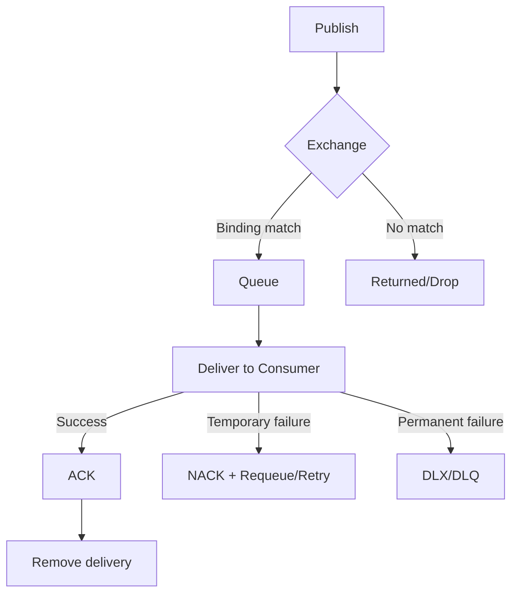
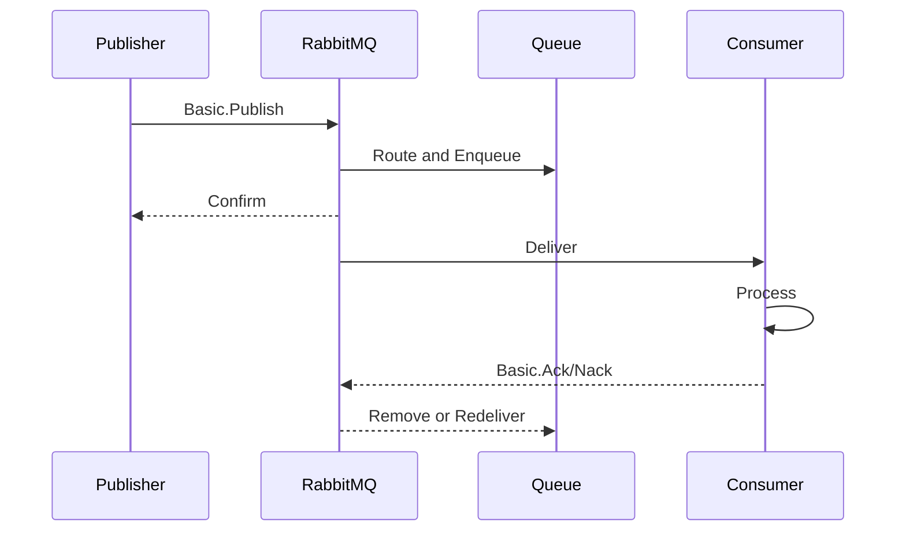

# فصل هفتم: چرخه عمر پیام

## فهرست مطالب
- [Publishing تا Ack](#publishing-تا-ack)
- [Enqueue و Delivery](#enqueue-و-delivery)
- [TTL و Expiration](#ttl-و-expiration)
- [دیاگرام Lifecycle](#دیاگرام-lifecycle)

## Publishing
Publisher پیام را روی Exchange منتشر می‌کند و می‌تواند Properties مثل `DeliveryMode`، `MessageId`، `CorrelationId` و `ContentType` را تنظیم کند.

در RabbitMQ، Publisher Confirm تأیید ذخیره یا پذیرشِ پیام توسط Broker است؛ Consumer ACK تأیید پردازش توسط Consumer است.

## Routing و Enqueue
Broker Bindingها را بررسی می‌کند. اگر Queue مقصد نبود، `mandatory=true` می‌تواند پیام را به Publisher برگرداند یا رخداد Return را فعال کند.

## Delivery
Basic.Consume Push mode و Basic.Get Pull mode را فراهم می‌کند. برای Workerهای بلندمدت از Consumer/Push استفاده کنید؛ Basic.Get فقط برای بررسی یا jobهای متفرقه مناسب است.

## ACK و Requeue
- **ACK:** پردازش موفق است؛ RabbitMQ می‌تواند delivery را حذف کند.
- **NACK:** پردازش ناموفق است؛ با Requeue می‌تواند دوباره تحویل شود یا DLX کند.

ACK قبل از Commit یا ثبت نتیجه نباید ارسال شود. Requeue بی‌نهایت خطای دائمی را دنبال نمی‌کند؛ نیاز به max retry دارد.

## TTL و Expiration
`x-message-ttl` عمر پیام در Queue را محدود می‌کند؛ `x-expires` عمر Queue بلااستفاده را محدود می‌کند. پیامی که در Head Queue قرار دارد و expired می‌شود نمی‌تواند توسط Consumer دریافت شود، اما حذف دقیق به نوع Queue و وضعیت broker وابسته است.

## حذف پیام
ACK یا حذف دستی/Retention اقدام نهایی حذف است. حذف Queue همه پیام‌های داخل آن را حذف می‌کند و نباید برای پاکسازی مالی یا Auditing به‌تنهایی استفاده شود.

## نمودار Lifecycle

## اشتباهات رایج
- عدم تمایز Confirm و ACK
- ارسال ACK قبل از ذخیره نتیجه
- انتظار TTL دقیق و فوری در همه Queueها
- عدم مدیریت Return برای پیام بی‌Route

## تمرین عملی
چرخه عمر یک `PaymentRequested` را از انتشار تا پرداخت و DLQ ترسیم کنید.

## منابع
- [RabbitMQ Reliability](https://www.rabbitmq.com/docs/reliability)
- [Publisher Confirms](https://www.rabbitmq.com/docs/confirms)
- [TTL](https://www.rabbitmq.com/docs/ttl)
