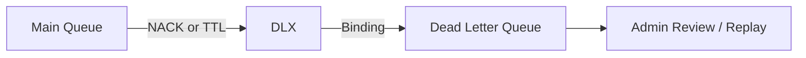

# فصل نهم: مدیریت خطا و پیام‌های ناموفق

## فهرست مطالب
- [TTL](#ttl)
- [DLX و DLQ](#dlx-و-dlq)
- [Retry و Backoff](#retry-و-backoff)
- [Retry Architecture](#retry-architecture)

## TTL
**Message TTL** عمر پیام را محدود می‌کند؛ **Queue TTL** عمر Queue بلااستفاده را. برای TTL های قابل پیش‌بینی با x-message-ttl و x-expires دقیقاً رفتار Queue را آزمایش کنید؛ بعضی قابلیت‌های delayed delivery نیازمند Plugin هستند.

## DLX و DLQ
پیام ممکن است به دلایل زیر به **Dead Letter Exchange** برسد:
- NACK یا Reject با `requeue=false`
- انقضای پیام
- حداکثر طول صف و Drop policy

DLX یک Exchange معمولی است و Dead Letter Routing معمولاً از `x-dead-letter-routing-key` یا routing اصلی استفاده می‌کند.



## Retry
Retry محدود و دلایل موقت مانند timeout بهتر است. خطای دائمی باید مستقیماً به DLQ برسد:

- موقت: اتصال، timeout، 429، سرویس غیرعملیاتی
- دائمی: validation، payload منقضی، contract نامعتبر

## Exponential Backoff
برای تلاش‌های اول: 1 ثانیه، 2 ثانیه، 4 ثانیه، سپس سقف و jitter. Random jitter مانع همزمان شدن همه Retryها می‌شود.

## Poison Message
پیام Poison همیشه شکست می‌خورد؛ `x-death` headers تعداد تلاش‌ها را ثبت می‌کنند اما در طراحی نهایی، Retry Count صریح و Message Header قابل سنجش دارد.

## Retry Architecture
معماری:
1. `main.queue`
2. `retry.queue` با TTL
3. `main.dlx`
4. `dlq.queue`

برای Retry بهتر است هر تلاش پیام را دوباره به Main Exchange با افزایش count ارسال کند تا چرخه Requeue بی‌نهایت ایجاد نشود.

## C# Consumer با Retry Header
```csharp
const int maxAttempts = 4;

await foreach (var result in channel.GetAsyncEnumerable("main.queue"))
{
    var attempt = result.BasicProperties.Headers?
        .TryGetValue("x-retry-count", out var raw) == true
        ? Convert.ToInt32(raw) : 0;

    try
    {
        await ProcessAsync(result.Body.ToArray());
        await channel.BasicAckAsync(result.DeliveryTag, multiple: false);
    }
    catch (TemporaryException)
    {
        if (attempt >= maxAttempts)
        {
            await channel.BasicNackAsync(result.DeliveryTag, false, requeue: false);
        }
        else
        {
            await channel.BasicNackAsync(result.DeliveryTag, false, requeue: false);
            // publish to retry queue with TTL and x-retry-count
        }
    }
    catch (PermanentException)
    {
        await channel.BasicNackAsync(result.DeliveryTag, false, requeue: false);
    }
}
```

API فوق صرفاً نمونه مفهومی است؛ برای Consumer قابل اعتماد از `AsyncEventingBasicConsumer` یا `IAsyncBasicConsumer` متناسب با نسخه واقعی استفاده کنید.

## اشتباهات رایج
- Requeue روی خطای دائمی
- حدس زدنی بودن دلیل و تعداد Retry
- استفاده از retry مستقیم در Consumer بدون backoff
- عدم نگهداری trace و payload در DLQ

## تمرین عملی
یک Retry Queue با TTL 5 ثانیه و max attempts=3 بسازید و بررسی کنید در چه حالت‌هایی پیام به DLQ می‌رود.

## منابع
- [Dead Letter Exchanges](https://www.rabbitmq.com/docs/dlx)
- [TTL](https://www.rabbitmq.com/docs/ttl)
