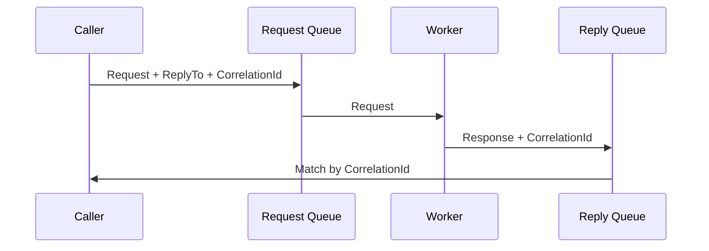
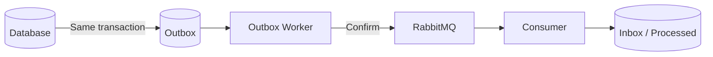
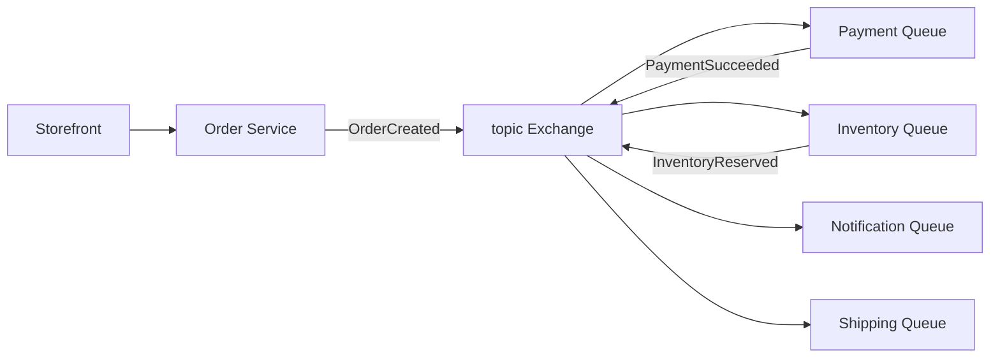

# فصل یازدهم: الگوهای معماری پیشرفته

## فهرست مطالب
- [Work Queue و Pub/Sub](#work-queue-و-pubsub)
- [RPC و Request/Reply](#rpc-و-requestreply)
- [Outbox و Inbox](#outbox-و-inbox)
- [Saga و EDA](#saga-و-eda)

## Work Queue
چند Worker یک Queue مشترک را مصرف می‌کنند و بار را تقسیم می‌کنند. مناسب برای Taskهای اجرای سنگین مثل thumbnail یا email.

## Publish/Subscribe
هر Subscriber یک Queue مستقل دارد که به Exchange binding می‌شود؛ همه نسخه‌ها فرصت دریافت می‌گیرند.

## Competing Consumers
چند Worker روی یک Queue کار را تقسیم می‌کنند. برای افزایش throughput مقیاس افقی می‌دهند، اما پردازش سخت وابسته به I/O و ordering را نادیده نمی‌گیرد.

## Request/Reply و RPC
Publisher یک CorrelationId و `ReplyTo` را تنظیم می‌کند؛ Worker پاسخ را روی Queue موقت یا اختصاصی می‌فرستد و Caller با CorrelationId پاسخ را تطبیق می‌دهد.

نکات RPC: Timeout، Retry محدود، پاسخ تکراری، مرز سرویس و کاربر غیرهم‌زمان را مد نظر داشته باشید. اگر RPC روی Payment یا Inventory حیاتی است، غالباً Http API یا Saga مناسب‌تر است.

## Outbox Pattern
در معماری پایگاه داده، مشکل Dual Write زمانی است که تغییر DB و Publish پیام باید با هم موفق شوند؛ پیام Broker می‌تواند ازدست رود یا Commit DB بدون پیام شکست بخورد.

راه‌حل:
1. تغییر Domain و ثبت Event در جدول Outbox در یک Transaction.
2. Worker جدایی‌پذیر رکوردهای Outbox را منتشر می‌کند.
3. Publisher Confirm دریافت می‌شود.
4. رکورد Outbox به وضعیت Published یا حذف می‌شود.

## Inbox/Deduplication
Consumer پیام را با `MessageId` در جدول Inbox ثبت و پردازش می‌کند. ثبت و عملیات به‌صورت transaction انجام شود تا پیام تکراری دوباره اجرا نشود.

## Saga
Saga یک دنباله تراکنش‌های توزیع‌شده است که در صورت شکست با **Compensating Transaction** جبران می‌شود.

- **Choreography:** هر سرویس خبر می‌گیرد و Event منتشر می‌کند.
- **Orchestration:** یک Saga Coordinator مسیر را هدایت می‌کند.

## Event-Driven Architecture
Event نشان‌دهنده واقعیت رخ‌داده است، نه دستور. نام‌ها قابل نسخه‌بندی، schema ثبت‌شده و زمان رخداد مشخص دارند. `Eventual Consistency` رفتار طبیعی EDA است.

## سناریوی فروشگاهی

- `Order Service` سفارش را ثبت و `OrderCreated` Outbox می‌کند.
- `Payment` پرداخت را اجرا و event پرداخت می‌دهد.
- `Inventory` موجودی را رزرو می‌کند.
- `Shipping` پس از پرداخت و رزرو ارسال را ایجاد می‌کند.
- `Notification` اطلاع‌رسانی می‌کند.

## اشتباهات رایج
- استفاده RPC به‌جای پیام برای workflow طولانی
- انتشار پیام خارج از transaction Outbox
- عدم Inbound Deduplication
- چندین Event نامنسجم برای یک زمان

## تمرین عملی
یک Saga سفارش طراحی کنید که شامل Compensation برای پرداخت ناموفق و عدم موجودی باشد.

## منابع
- [Microsoft Cloud Design Patterns](https://learn.microsoft.com/en-us/azure/architecture/patterns/)
- [Transactional Outbox](https://learn.microsoft.com/en-us/azure/architecture/databases/guide/transactional-outbox-cosmos)
