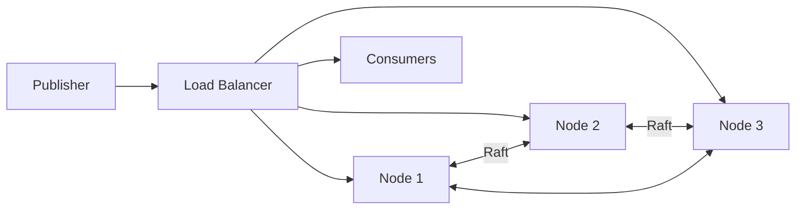

# فصل دوازدهم: مقیاس‌پذیری و دسترس‌پذیری

## فهرست مطالب
- [Scaling](#scaling)
- [Cluster و Replication](#cluster-و-replication)
- [Federation و Shovel](#federation-و-shovel)
- [سناریوی چند Node](#سناریوی-چند-node)

## Scaling
**Vertical Scaling** منابع یک Node را افزایش می‌دهد؛ **Horizontal Scaling** تعداد Node/Consumer را بالا می‌برد. RabbitMQ Consumerها را عمودی یا افقی مقیاس می‌کند، اما Queueها و Replicaها نیز باید برنامهریزی شوند.

## High Availability
HA به قابلیت ادامه‌خدمات پس از شکست اشاره دارد. Quorum Queue روی اکثریت Nodeهای cluster بر پایه Raft replication می‌ماند.

تعداد گره‌های مجزا و rule اکثریت را در نظر بگیرید؛ replication روی یک disk Node نیست. برای RabbitMQ بهتر است clusterهایی با topology و failure domain مناسب ساخته شوند.

## Clustering
Cluster Nodeها را روی configuration, exchange و queue metadata همراه می‌کند. پربارترین بخش حواصیل پیام و throughput است؛ نباید همه Clientها به یک Node یا Load Balancer سنتی متصل باشند بدون health check.

## Replication
- Quorum Queue: replicaهای پایدار برای داده حساس
- Stream: replay و replication
- Classic: برای کارها سبک یا legacy؛ انتخاب پیش‌فرض جدید production Quorum است مگر نیازی خاص باشد

## Federation
Federation برای اتصال clusterهای RabbitMQ در مناطقههای جغرافیایی یا domainهای مختلف است. Exchange یا Queue را بین upstream و downstream همگام می‌کند و برای WAN مناسب‌تر از full cluster replication است.

## Shovel
Shovel یک پیام را از Broker به Broker دیگر به‌صورت push یا pull منتقل می‌کند. برای migration، bridge یا route بین سیستم‌های جدا کاربرد دارد.

## Load Balancing
Load Balancer میان Connectionها را تقسیم می‌کند. نباید آن را همان Message Distribution دانست. برای تشخیص Node سالم از health check و TCP probe استفاده کنید.

## سناریوی چند Node

اگر Leader Quorum Queue از بین رفت، اکثریت باقیمانده نقش Leader را انتخاب می‌کنند و Consumers reconnect می‌شوند. اگر اکثریت از دست رفت، Queue در وضعیت recovery قرار می‌گیرد.

## اشتباهات رایج
- اجرای یک Container/broker بدون persistent volume
- cluster کردن همزمان Nodeهای روی همان Failure Domain
- پخش Load بالانس روی همه Nodeها بدون healthcheck
- انتظار HA از Classic Queue روی چند Node

## تمرین عملی
یک cluster سه Node طراحی کنید و سناریو خاموش شدن هر Node را با توجه به اکثریت و Consumer reconnect بررسی کنید.

## منابع
- [RabbitMQ Clustering](https://www.rabbitmq.com/docs/clustering)
- [Quorum Queues](https://www.rabbitmq.com/docs/quorum-queues)
- [Federation](https://www.rabbitmq.com/docs/federation)
- [Shovel](https://www.rabbitmq.com/docs/shovel)
