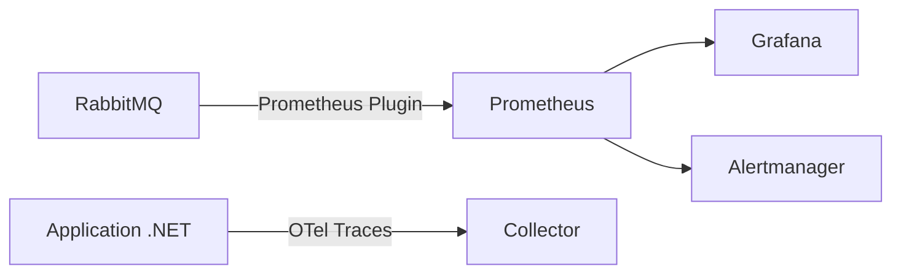

# فصل چهاردهم: مانیتورینگ و مدیریت منابع

## فهرست مطالب
- [Management UI](#management-ui)
- [Queue Metrics](#queue-metrics)
- [Memory و Disk](#memory-و-disk)
- [Observability](#observability)

## Management UI
Management Plugin امکانات مشاهده Connection، Channel، Exchange، Queue، user و policy را فراهم می‌کند. برای Production باید دسترسی محدود، TLS و credential جدا داشته باشد.

## Queue Metrics
- `Ready`: پیام آماده تحویل
- `Unacked`: تحویل‌شده اما ACK نشده
- `Consumers`: تعداد Consumer فعال
- `Message rates`: publish/delivery/ack/redelivery

Alert پایه: Queue depth پیوسته، consumer count صفر، redelivery بالا، unacked رشدکننده و oldest message تجاوز از SLA.

## Consumer Utilization
Consumer Utilization نسبت ظرفیت پردازش Consumer فعلی است. برای تشخیص کمبود، نرخ Incoming و Ack را مقایسه کنید.

## Memory و Disk
Memory Alarm به Broker دستور flow control می‌دهد تا مصرف افزوده کاهش یابد. Disk Alarm مانع ادامه persistence می‌شود.

برای Production:
- disk free limit را با فضای واقعی تنظیم کنید
- memory watermark را پایدار نگه دارید
- paging و disk write را در dashboard ببینید

## Metrics
Prometheus Plugin endpoint متریکهای Broker را ارائه می‌دهد؛ Grafana می‌تواند نمودارها را بسازد:
- RabbitMQ ready/unacked
- publish/deliver/ack rate
- memory/disk usage
- consumer count
- connection/channel count

اگر OpenTelemetry بر روی Client فعال شود، correlation و trace را می‌توان با Service Traceها ادغام کرد، ولی پشتیبانی پیام Client به نسخه و instrumentation وابسته است.

## سناریوی عملی

Dashboardهای پیشنهادی:
1. Queue ready/unacked
2. Publish/delivery/ack/redelivery rates
3. Consumer count/utilization
4. Memory/disk status
5. Connection/channel count

## اشتباهات رایج
- مانیتور کردن فقط CPU
- نداشتن Alert برای unacked و redelivery
- فعال کردن management بدون کنترل دسترسی
- نادیده گرفتن disk alarm

## منابع
- [RabbitMQ Monitoring](https://www.rabbitmq.com/docs/monitoring)
- [Prometheus Plugin](https://www.rabbitmq.com/docs/prometheus)
