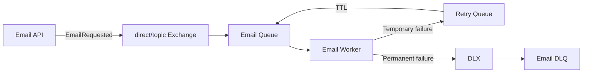
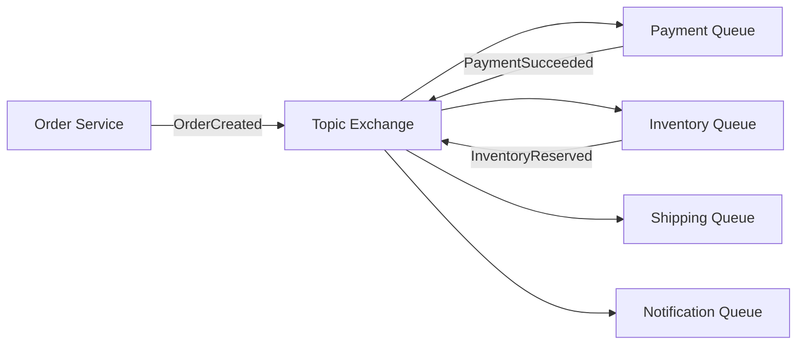
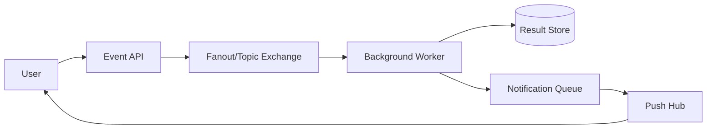

# فصل شانزدهم: پروژه‌های واقعی

## پروژه ۱: سیستم ارسال ایمیل

### صورت مسئله
Request ارسال ایمیل سریع پاسخ دهد ولی ارسال واقعی توسط Worker انجام شود.



### ساختار
- `EmailRequestedEvent` با MessageId و Recipient
- Durable queue و Persistent message
- Manual ACK فقط بعد از ارسال موفق
- Retry count و exponential backoff
- DLQ برای خطاهای باقی‌مانده

### تست
- SMTP success
- timeout
- invalid address
- duplicate MessageId

## پروژه ۲: سیستم پردازش سفارش

### صورت مسئله
سرویس‌های Order، Payment، Inventory و Notification باید با Eventهای ناهمزمان هماهنگ شوند.



### مدل‌ها
- `OrderCreated`
- `PaymentSucceeded`
- `PaymentFailed`
- `InventoryReserved`
- `InventoryRejected`
- `ShipmentScheduled`

### نکات
- جدول Outbox در Order و Payment
- Inbox/Deduplication در Consumerها
- Compensation برای لغو موجودی یا refund
- DLQ برای خطاهای business/technical

## پروژه ۳: اعلان Real-time و پردازش Background

### صورت مسئله
یک Event ثبت شده باشد، Worker نتیجه را ذخیره کند و SignalR یا Push/SSE به کاربر برود.



### تست‌های موردنیاز
- پردازش موفق
- retry موقت
- replay تکراری
- crash بعد از پرداخت قبل از ACK
- crash Worker و عدم تکرار عملیات

## ساختار Solution مشترک

```text
Solution/
├── src/
│   ├── Api/
│   ├── Worker/
│   └── Shared.Contracts/
├── tests/
└── docker-compose.yml
```

## آزمون Production
- Publisher confirms فعال
- Automatic recovery
- health endpoint برای RabbitMQ
- metric و trace
- message schema و migration policy
- periodic DLQ review

## تمرین‌های پروژه
- یک زیر پروژه را اجرا کنید
- خطای ۳ بار را تست کنید
- امتیاز Outbox را از چند transaction بسنجید
