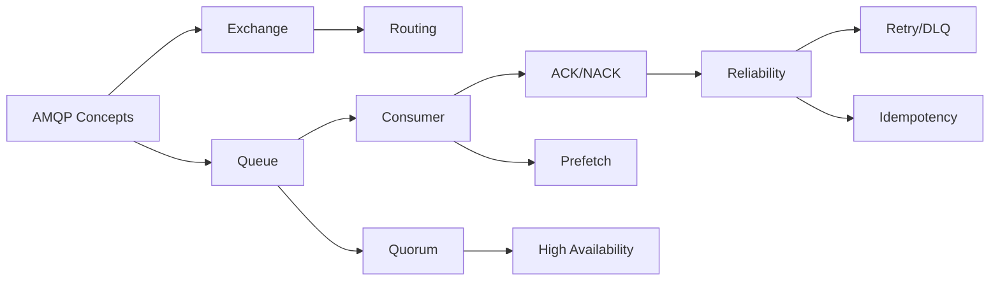

# فصل بیست‌ویکم: جمع‌بندی و نقشه راه

## جمع‌بندی مفاهیم

| موضوع | اهمیت |
|---|---|
| Message Broker | جداسازی Publisher و Consumer |
| Exchange | انتخاب مسیر پیام |
| Queue | نگهداری و تحویل کار |
| Routing | binding و routing key |
| ACK/NACK | کنترل پردازش |
| Confirm | اطمینان از پذیرش broker |
| Persistence | ماندگاری داده و ساختار |
| Quorum | high availability data |
| DLX/DLQ | مدیریت پیام ناموفق |
| Prefetch | Backpressure و throughput |
| Idempotency | duplicate safety |
| Outbox | جلوگیری از dual write |

## نقشه راه Beginner
1. مبانی messaging
2. AMQP 0-9-1
3. Connection و Channel
4. Exchange و Queue
5. Producer و Consumer
6. ACK

## نقشه راه Intermediate
1. Routing و topic
2. Publisher Confirm
3. Persistence و quorum
4. Manual ACK
5. Retry/DLX/DLQ
6. Prefetch و concurrency

## نقشه راه Advanced
1. Outbox و Inbox
2. Saga و Event-driven
3. Cluster و replication
4. Security و TLS
5. monitoring و alerting
6. high availability
7. .NET worker architecture

## وابستگی مفاهیم

## مهم‌ترین مفاهیم برای پروژه واقعی
- Publisher Confirm و Consumer ACK را جدا درک کنید.
- Durable، Persistent و Replication را با هم بررسی کنید.
- همه Consumerها Idempotent باشند.
- Outbox برای transaction/event consistency داشته باشید.
- DLQ و alert برای خطاها ایجاد کنید.
- Prefetch و concurrency را load test کنید.
- TLS و least privilege را از روز اول اعمال کنید.

## Production Checklist

- [ ] Connection lifecycle و recovery
- [ ] Channel lifecycle و no concurrent misuse
- [ ] Quorum/Stream queue انتخاب‌شده بر اساس نیاز
- [ ] confirm و ack
- [ ] persistent message
- [ ] idempotency/deduplication
- [ ] retry/backoff/maximum attempts
- [ ] DLX/DLQ
- [ ] monitoring/alerting
- [ ] memory/disk alarms
- [ ] TLS and secrets
- [ ] least privilege
- [ ] recovery test
- [ ] schema versioning
- [ ] chaos/failure testing
