# آموزش جامع RabbitMQ؛ از مقدماتی تا پیشرفته

این ریپوزیتوری یک مسیر یادگیری گام‌به‌گام فارسی برای RabbitMQ و معماری سیستم‌های پیام‌محور است. تمرکز آن بر مفاهیم کاربردی، AMQP 0-9-1، طراحی قابل اعتماد، ایمنی عملیاتی و پیاده‌سازی با C#/.NET است.

## معرفی RabbitMQ

RabbitMQ یک **Message Broker** است که پیام‌ها را از Publisher دریافت، با Exchange و Binding مسیریابی، و در Queue تحویل به Consumer می‌کند. در این آموزش، اصطلاحات انگلیسی کنار معادل فارسی نگه داشته شده‌اند تا خواننده هم برای مستندات رسمی و مصاحبه و هم برای طراحی واقعی آماده باشد.

## هدف این ریپوزیتوری

- درک مبانی پیام‌رسانی هم‌زمان و غیرهم‌زمان
- یادگیری معماری AMQP 0-9-1 و اجزای RabbitMQ
- طراحی Routing، Retry، DLQ، Publisher Confirms و Idempotency
- ساخت Consumerهای امن با RabbitMQ .NET Client
- طراحی مقیاس‌پذیر، امن و قابل مشاهده برای Production

## پیش‌نیازها

- مبانی شبکه و HTTP
- مفاهیم پایه C# و async/await
- آشنایی اولیه با ASP.NET Core و Docker
- درک اصول سرویس‌های توزیع‌شده و تست برنامه

## ابزارهای موردنیاز

- Docker Desktop یا Docker Engine
- .NET SDK 8 یا جدیدتر
- RabbitMQ 4.x
- RabbitMQ .NET Client 7.x
- SQL یا یک پایگاه داده برای نمونه‌های پیاده‌سازی

> نسخه‌های فعال را در اجرای واقعی بررسی کنید؛ نمونه‌ها برای **RabbitMQ 4.x** و **RabbitMQ.Client 7.x** نوشته شده‌اند. APIهای نسخه‌های قدیمی با آن‌ها ترکیب نشده‌اند.

## نقشه راه یادگیری

```mermaid
flowchart LR
  A[مبانی Messaging] --> B[AMQP و معماری]
  B --> C[Exchange و Queue]
  C --> D[Routing و Lifecycle]
  D --> E[Reliability و Error Handling]
  E --> F[Consumer Processing]
  F --> G[Patterns و HA]
  G --> H[Security و Monitoring]
  H --> I[پیاده‌سازی .NET]
  I --> J[پروژه‌های واقعی]
```



## فهرست مطالب

| فصل | موضوع |
|---|---|
| [۱](./01-Messaging-Fundamentals/README.md) | مبانی سیستم‌های پیام‌رسانی |
| [۲](./02-Messaging-Protocols/README.md) | پروتکل‌های پیام‌رسانی |
| [۳](./03-RabbitMQ-Architecture/README.md) | معماری داخلی RabbitMQ |
| [۴](./04-Exchange-Types/README.md) | انواع Exchange |
| [۵](./05-Queue-Types/README.md) | انواع Queue |
| [۶](./06-Message-Routing/README.md) | مسیریابی پیام |
| [۷](./07-Message-Lifecycle/README.md) | چرخه عمر پیام |
| [۸](./08-Message-Reliability/README.md) | قابلیت اطمینان پیام |
| [۹](./09-Error-Handling/README.md) | مدیریت خطا |
| [۱۰](./10-Consumer-Processing/README.md) | کنترل پردازش Consumer |
| [۱۱](./11-Architecture-Patterns/README.md) | الگوهای معماری |
| [۱۲](./12-Scalability-Availability/README.md) | مقیاس‌پذیری و دسترس‌پذیری |
| [۱۳](./13-Security/README.md) | امنیت |
| [۱۴](./14-Monitoring-Management/README.md) | مانیتورینگ و مدیریت |
| [۱۵](./15-DotNet-Implementation/README.md) | پیاده‌سازی C# و .NET |
| [۱۶](./16-Real-World-Projects/README.md) | پروژه‌های واقعی |
| [۱۷](./17-References/README.md) | منابع معتبر |
| [۱۸](./18-Best-Practices/README.md) | اشتباهات رایج و Best Practices |
| [۱۹](./19-Interview-Questions/README.md) | سؤالات مصاحبه |
| [۲۰](./20-Practical-Exercises/README.md) | تمرین‌های عملی |
| [۲۱](./21-Summary-Roadmap/README.md) | جمع‌بندی و نقشه راه |

## شروع سریع

```bash
docker run --detach --name rabbitmq \
  --publish 5672:5672 --publish 15672:15672 \
  rabbitmq:4-management
```

داشبورد: `http://localhost:15672`

مقدارهای اولیه Docker Image عموماً `guest/guest` هستند اما برای Production نباید استفاده شوند. برای دسترسی از بیرون کانتینر یا از برنامه Host، نام کاربری و رمز Production را تنظیم کنید.

## منابع معتبر

- [RabbitMQ Documentation](https://www.rabbitmq.com/docs)
- [RabbitMQ Tutorials](https://www.rabbitmq.com/tutorials)
- [RabbitMQ .NET Client](https://www.rabbitmq.com/client-libraries/dotnet-api-guide)
- [RabbitMQ .NET Client GitHub](https://github.com/rabbitmq/rabbitmq-dotnet-client)
- [Microsoft Cloud Design Patterns](https://learn.microsoft.com/en-us/azure/architecture/patterns/)
